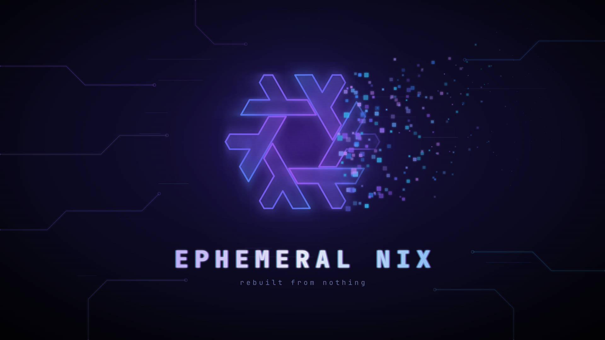

# Ephemeral Nix

[](https://github.com/the-wittch/ephemeral-nixos/actions/workflows/ci.yml) [](https://github.com/the-wittch/ephemeral-nixos/releases/latest)



An installer for NixOS on an encrypted btrfs disk where `/` is wiped on every boot. Only `/home` and a short list of system paths survive, on `/persist`. You pick Plasma, GNOME, niri or Umbriel (both with Noctalia) during the install.

More at [ephemeral-nix.sh](https://ephemeral-nix.sh/).

```
disk ─ ESP (/boot, 1G)
     └ LUKS2 ─ btrfs: root, root-blank, nix, persist, log, swap
```

Machine details (hostname, user, disk, desktop) live in `settings.json`, which is gitignored. The login password hash lives in `/persist/passwords/`, never in the flake.

> [!NOTE]
> Ephemeral Nix is a solo passion project. I read every issue and get to each one as quickly as I can, but there's one of me, so there's no set response time.

## Limits

- x86_64 with UEFI, Secure Boot off for the install. The installer can [set it up](https://github.com/the-wittch/ephemeral-nixos-config/blob/main/docs/security.md#secure-boot) with keys made on the machine. See [Hardware](docs/hardware.md) for what's been tested.
- Installing wipes the whole disk, and reinstalling wipes it again, `/persist` included. Make a [backup](https://github.com/the-wittch/ephemeral-nixos-config/blob/main/docs/backup.md) first. No dual boot.
- One user per machine.
- Suspend works; hibernation doesn't.
- The disk unlocks with a passphrase. Once Secure Boot is on, the config can add the TPM and a PIN ([TPM unlock](https://github.com/the-wittch/ephemeral-nixos-config/blob/main/docs/security.md#tpm-unlock)).
- It's opinionated: Catppuccin, Ghostty and zsh by default. Changing them takes a module of your own ([appearance](https://github.com/the-wittch/ephemeral-nixos-config/blob/main/docs/appearance.md)).

## Before you install

- **Back up** anything on the disk you want to keep. The whole disk is erased.
- In the firmware settings, **turn off Secure Boot** and boot in **UEFI** mode. To have the installer set up Secure Boot, also put the firmware in Setup Mode, ideally by deleting only the platform key (PK); the [config's steps](https://github.com/the-wittch/ephemeral-nixos-config/blob/main/docs/security.md#secure-boot) say where to find it, and what not to pick on a Framework.
- **Unplug other disks** you don't mean to install on, especially one with an older Ephemeral Nix install: the new system boots by partition names that one has too, so the installer refuses while it's attached. It also refuses a disk that's part of an LVM volume group, ZFS pool or RAID array, since erasing it would break that on the other disks too.
- **Pick a passphrase you can type at the boot screen.** It uses the keyboard layout you choose in the installer; the installer switches to it before asking, where it can.
- Have **Wi-Fi or a cable** ready. The installer downloads the system while it installs.

## Install

### From the ISO (easiest)

Download the `.iso` and `SHA256SUMS` from the latest [release](https://github.com/the-wittch/ephemeral-nixos/releases), check it, and write it to a USB stick. Each check proves something different. The checksum only catches a damaged download, since it comes from the same release as the ISO. From v3.2.4 on, `gh attestation verify` proves the ISO was built by this repo's ISO workflow, and from which commit. From v3.7.3 on, releases can't be changed once they're published, and `gh release verify-asset` proves the ISO is the one the release went out with. None of them says whether that commit is one to trust: the attestation names the commit, so compare it with `COMMIT` in [`RELEASE`](./RELEASE) on the release's tag to tie the ISO to source you can read.

```bash
sha256sum -c SHA256SUMS
gh attestation verify ephemeral-nix-*.iso -R the-wittch/ephemeral-nixos --signer-workflow the-wittch/ephemeral-nixos/.github/workflows/iso.yml
gh release verify-asset ephemeral-nix-*.iso -R the-wittch/ephemeral-nixos
sudo dd if=ephemeral-nix-*.iso of=/dev/sdX bs=4M status=progress oflag=sync
```

Boot it in UEFI mode. The installer starts on its own, one question per screen: `esc` goes back, and a review screen at the end lets you change any answer before anything is written. With no network yet, it starts on Connect to Wi-Fi, and moves on to Install once it's online. The Wi-Fi network you join is copied to the new system. Run `ephemeral-install` to start it again; if you leave it while it's installing, the install carries on and running it again picks it back up.

### From the NixOS ISO

Boot the NixOS graphical ISO in UEFI mode and connect to the network, then use one of the ways below.

#### From a release (recommended)

Take the tag and commit from the latest [release](https://github.com/the-wittch/ephemeral-nixos/releases), or from [`RELEASE`](./RELEASE) on that tag, and check the clone against them:

```bash
TAG=v3.11.0
REV=84db86d58ee221411f8551bfee9cb52c257cca53
git clone --branch "$TAG" --depth 1 https://github.com/the-wittch/ephemeral-nixos.git ~/nix
cd ~/nix
[[ $(git rev-parse HEAD) == "$REV" ]] || echo "hash mismatch, stop here"
sudo ./scripts/tui.sh
```

Or let the bootstrap script clone and check it:

```bash
curl -fsSL https://raw.githubusercontent.com/the-wittch/ephemeral-nixos/v3.11.0/scripts/bootstrap-tui.sh -o /tmp/bootstrap-tui.sh
sudo env TAG=v3.11.0 EXPECTED_REV=84db86d58ee221411f8551bfee9cb52c257cca53 bash /tmp/bootstrap-tui.sh
```

Release tags are signed, so GitHub shows them as Verified. [Weekly releases](docs/development.md) are tagged by CI and aren't signed. From v3.7.3 on, GitHub signs a record of every release's tag and files instead, which `gh release verify "$TAG" -R the-wittch/ephemeral-nixos` checks. Checking the commit hash as above works for every release.

#### From main

```bash
git clone https://github.com/the-wittch/ephemeral-nixos.git ~/nix
cd ~/nix
sudo ./scripts/tui.sh
```

Without the menus:

```bash
curl -fsSL https://raw.githubusercontent.com/the-wittch/ephemeral-nixos/main/scripts/bootstrap.sh | sudo env SWAP_SIZE=4G bash -s -- /dev/vda
```

Use `sudo env VAR=...`. Plain `sudo VAR=...` usually drops the variables.

Without the menus, it doesn't ask for the hostname, user, swap size or timezone, and it skips the app list, so you get the apps ticked by default. It uses `nixos`, `nixuser`, `4G` and `UTC` unless you set them, as in [Unattended installs](docs/unattended.md).

### What it asks

The screens come in this order:

1. **Disk** and **desktop**, or none for a server you only reach over SSH.
2. **Graphics**, only when it finds an NVIDIA card: it shows the card and asks for `open` (RTX 20 / GTX 16 series and newer), `legacy` (GTX 900 / 10 series) or `none`. The driver is compiled during the install, which adds a few minutes.
3. **Region:** keyboard layout, language and timezone; type to search the lists.
4. **Install type:** the full system, or a small install, a plain desktop finished later with `ephemeral-setup`.
5. **Options**, full system only: the extra shell tools (atuin, fzf, bat, fastfetch and more), OpenSnitch (with a desktop), the Proton Pass SSH agent, and where DNS goes: the network's own, or encrypted to Cloudflare, Quad9, AdGuard, Control D or servers you name. Fingerprint login when it finds a reader, and last, Secure Boot with keys made on the machine; with the firmware in Setup Mode, they go into it during the install. A battery turns on the laptop extras without asking.
6. **Apps**, full system only: the same list as `ephemeral-apps`, with Firefox, VLC and a few tools ticked to start with, and Steam, VS Code, Brave and Nerd Fonts among those to pick. `/` searches all of them. Without a desktop, only the terminal apps.
7. **Machine:** hostname, user and swap size.
8. **Server:** whether it stays on and takes SSH logins with keys only, and the public keys that may log in. Paste them, or type `github:yourname` to fetch the ones on your GitHub account. A server's disk can be unlocked over SSH after a reboot, so the install makes a host key for that, and prints its fingerprint at the end to check the first time you connect. The config's [servers page](https://github.com/the-wittch/ephemeral-nixos-config/blob/main/docs/servers.md) has the rest.
9. **Secrets:** the LUKS passphrase and the login password. With a non-US layout it switches the console to that layout first, so you type the passphrase the way you will at boot; where it can't, it says so.

It detects the rest of your hardware once the disk is mounted. When it's done, remove the ISO and reboot.

### In a VM

Use UEFI with Secure Boot off and a VirtIO disk (`/dev/vda`). 64 GB of disk and 8 GB of RAM is plenty. The boot splash can look odd on virtual GPUs; unlocking still works.

## After the install

The config is at `/persist/etc/nixos`. After changing it, rebuild with:

```bash
ephemeral-update
```

`ephemeral-doctor` checks that everything is as it should be, and says how to fix what isn't.

To see the wipe working: `sudo touch /ephemeral-test`, put a file in `~`, and reboot. The first is gone, the second is still there.

A read-only copy of the config as installed is kept in `/persist/etc/nixos-install`. However far `/persist/etc/nixos` moves on, this gets the fresh-install system back, and your files stay:

```bash
ephemeral-update --as-installed
```

### Changing it later

`ephemeral-setup` changes what's installed: the profile, OpenSnitch, the Proton Pass SSH agent and where DNS goes. After a small install, run it to get the full system. The [config's README](https://github.com/the-wittch/ephemeral-nixos-config#setup) covers the rest, including `ephemeral-apps` for apps.

## How it works

This repo is the installer and nothing else. Its `flake.nix` is the machine flake that gets installed to `/persist/etc/nixos`:

```nix
{
  inputs = {
    ephemeral.url = "github:the-wittch/ephemeral-nixos-config/v4.20.0";
    # the installer runs nixpkgs tools by name
    nixpkgs.follows = "ephemeral/nixpkgs";
  };
  outputs = inputs: inputs.ephemeral.lib.mkFlake { inherit inputs; root = ./.; };
}
```

Every module, the partition layout included, comes from that pinned release of the config repo; `flake.lock` pins the rest. Each installer release pins a tested config release. This repo's own `modules/` and `installer/` only hold the ISO, its installer screens and the install test, which machines never see.

## Wallpaper

The wallpaper and default user picture come from the [config repo](https://github.com/the-wittch/ephemeral-nixos-config/blob/main/docs/appearance.md#wallpaper), which also lists the credits for the snowflake.

## Documentation

- [Unattended installs](docs/unattended.md): every question answered ahead of time
- [settings.json and unfree packages](docs/settings.md)
- [Troubleshooting](docs/troubleshooting.md): install problems, and where to report them
- [Manual install](docs/manual-install.md): the same steps without the scripts
- [Hardware](docs/hardware.md): what's required, what's tested and what the installer detects
- [Working on the installer](docs/development.md): files, CI and the install test
- [Architecture](ARCHITECTURE.md): how the installer is built, and the rules a change to it is checked against
- [The config's docs](https://github.com/the-wittch/ephemeral-nixos-config#documentation): everything after the install
